<!-- ░░░ HERO ░░░ -->

─────── ◇ ───────

<!-- ░░░ POINT OF VIEW ░░░ -->
<table width="100%">
<tr>
<td width="60%" valign="top">

### The point of view

> I started with a pencil — sketching, painting, grades in drawing — and moved to building things people actually use. Clean interfaces, honest work, and shipping something useful.

Small teams, ambitious ideas, and collaborations that matter.

</td>
<td width="40%" valign="top">

`PROFILE`

ROLE&nbsp;&nbsp;·&nbsp; Frontend & full-stack engineer 
BASED&nbsp;·&nbsp; Mumbai, India 🏔️ 
NOW&nbsp;&nbsp;&nbsp;·&nbsp; Building <b>JARVIS</b>, a local AI companion 
NEXT&nbsp;&nbsp;·&nbsp; ML engineer → my own products

</td>
</tr>
</table>

─────── ◇ ───────

<!-- ░░░ STACK ░░░ -->
### Production palette

tools chosen for the work, not the trend

─────── ◇ ───────

<!-- ░░░ FEATURED ░░░ -->
### In the current cut

**Client work** — [Westhide](https://westhide.co.in) · [SpaceBricks](https://spacebricks.in) · [Dravika Interiors](https://dravikainteriors.com) · [Sneha Arthues](https://snehaarthues.studio) · [Wearanake](https://wearanake.com) · [Chatkaro Foods](https://chatkarofoods.com)

12 sites live for real users · a reel that hit 182K views · first call is free, replies within 2 days.

─────── ◇ ───────

<!-- ░░░ STATS ░░░ -->

### By the numbers

<!-- ░░░ CONTRIBUTION TRAIL ░░░ -->
### Contribution trail

My contribution graph, eaten by a snake 🐍 — regenerated every 12 h by a GitHub Action.

<picture>
  <source media="(prefers-color-scheme: dark)" srcset="https://raw.githubusercontent.com/shubh74/shubh74/output/github-contribution-grid-snake-dark.svg" />
  <source media="(prefers-color-scheme: light)" srcset="https://raw.githubusercontent.com/shubh74/shubh74/output/github-contribution-grid-snake.svg" />
  
</picture>

─────── ◇ ───────

<!-- ░░░ FOOTER ░░░ -->

### Keep the story moving

I enjoy working with people who care about the details, share context, and ship something useful.

<a href="https://wa.me/917977788566"><b>WhatsApp</b></a> · <a href="mailto:shubhmehta.tech@gmail.com">Email</a> · <a href="https://ig.me/m/coderking__1">Instagram DM</a> · <a href="https://shubhmehta.me">shubhmehta.me</a>

